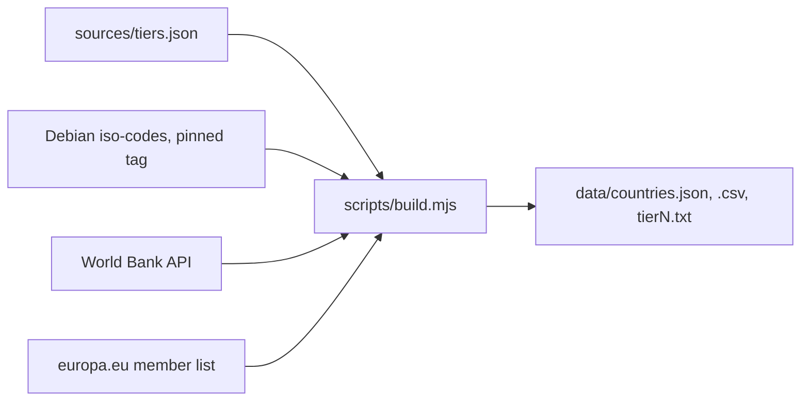

# country-tiers

**Tier 1, Tier 2 and Tier 3 countries as clean data, with ISO codes, World Bank income groups and EU/EEA flags.**

[](https://github.com/moonetix/country-tiers/actions/workflows/ci.yml)
[](https://github.com/moonetix/country-tiers/actions/workflows/refresh.yml)
[](data/countries.json)
[](LICENSE)
[](data/SOURCES.md)
[](https://moonetix.com/academy/glossary/tier-1-2-3-countries)

Maintained by [Moonetix](https://moonetix.com).

Every insertion order, offer page and offerwall dashboard says "Tier 1" sooner or later, and everyone keeps a slightly different copy of the list in a spreadsheet. This repo is that list as data: one row for each of the 249 ISO 3166-1 codes plus Kosovo, a tier for each, and the objective fields you usually have to join by hand. JSON, CSV and plain ISO lists, plus small helpers in JavaScript, PHP and Python that behave identically.

> [!IMPORTANT]
> Tiers are an industry convention, not an official standard. Ad networks, affiliate networks and offerwalls each draw the lines a little differently and move them as markets change. This repo follows one published definition, marks the countries networks disagree on, and keeps the official fields (ISO, World Bank, EU) separate from the editorial one (tier).

## The tiers

| Tier | Countries | Named in the reference article | Placed by rule |
| --- | ---: | --- | --- |
| **Tier 1** | 20 | US, CA, GB, AU, NZ, IE, DE, FR, NL, BE, LU, CH, AT, DK, NO, SE, FI | IS, LI, MC |
| **Tier 2** | 73 | ES, IT, PT, PL, CZ, HU, GR, SK, SI, HR, EE, LV, LT, IL, JP, KR, SG, HK, TW, AE, SA, QA, CL, UY, BR, MX, AR, TR, ZA | 44 other World Bank high-income economies, from Bulgaria, Cyprus, Kuwait, Oman and Romania to Puerto Rico and Jersey |
| **Tier 3** | 157 | IN, PK, BD, ID, PH, VN, EG, NG, KE, MA, CO, PE, UA | Everything else, including China, Malaysia, Thailand and most of Africa, Central Asia and Latin America |

Full lists: [tier1.txt](data/tier1.txt), [tier2.txt](data/tier2.txt), [tier3.txt](data/tier3.txt).

**Contested placements** are in `alt_tiers`. Brazil, Mexico, Argentina, Türkiye and South Africa are Tier 2 here and Tier 3 on many networks. Japan, Singapore and the United Arab Emirates are Tier 2 here and Tier 1 on some. Many short lists keep Tier 1 to the US, Canada, the UK and Australia only.

## Get the data

No install needed. Pull a file straight from GitHub:

```sh
curl -sO https://raw.githubusercontent.com/moonetix/country-tiers/main/data/countries.json
curl -s https://raw.githubusercontent.com/moonetix/country-tiers/main/data/tier1.txt | paste -sd, -
# AT,AU,BE,CA,CH,DE,DK,FI,FR,GB,IE,IS,LI,LU,MC,NL,NO,NZ,SE,US
```

| File | What it is |
| --- | --- |
| [`data/countries.json`](data/countries.json) | One object per country, all fields below. One country per line, so diffs stay readable. |
| [`data/countries.csv`](data/countries.csv) | The same, UTF-8. `alt_tiers` is pipe-separated, nulls are empty cells. |
| [`data/tier1.txt`](data/tier1.txt), [`tier2.txt`](data/tier2.txt), [`tier3.txt`](data/tier3.txt) | ISO alpha-2 codes, one per line, sorted. |
| [`data/countries.schema.json`](data/countries.schema.json) | JSON Schema (draft 2020-12) for `countries.json`. |
| [`data/sources.json`](data/sources.json) | Source versions, licenses and the date the data last changed. |

A row:

```json
{"iso2":"BR","iso3":"BRA","numeric":"076","name":"Brazil","common_name":"Brazil","iso_status":"official","tier":2,"tier_basis":"named","alt_tiers":[3],"income_group":"Upper middle income","income_code":"UMC","region":"Latin America & Caribbean","region_code":"LCN","eu_member":false,"eu_territory":false,"eea_member":false}
```

| Field | Meaning |
| --- | --- |
| `iso2`, `iso3`, `numeric` | ISO 3166-1 codes. `numeric` is a zero-padded string, `null` for XK. |
| `name`, `common_name` | ISO English short name ("Korea, Republic of") and the common name where one exists ("South Korea"). |
| `iso_status` | `official`, or `user-assigned` for XK (Kosovo), which GeoIP databases and ad platforms return although ISO has not assigned it. |
| `tier`, `tier_basis` | 1, 2 or 3. `named` if the reference article names the country, `rule` if it was placed by the rule below. |
| `alt_tiers` | Other tiers networks commonly use for the country. |
| `income_group`, `income_code` | World Bank income group (`HIC`, `UMC`, `LMC`, `LIC`). `null` where the World Bank does not classify the economy, such as Taiwan. |
| `region`, `region_code` | World Bank region. |
| `eu_member` | One of the 27 EU member states. |
| `eu_territory` | Member state, or an area with its own ISO code that is part of the EU: French Guiana, Guadeloupe, Martinique, Mayotte, Réunion, Saint-Martin and Åland. Use this one for consent and GDPR decisions keyed on a GeoIP country. |
| `eea_member` | EU member state, Iceland, Liechtenstein or Norway. |

## Use it from code

The helpers read `data/countries.json` and have no dependencies. They accept alpha-2 or alpha-3 in any case, and `UK` for `GB`. All three run the same [test vectors](test/vectors.json).

**JavaScript** (Node 22+, any bundler that supports JSON import attributes)

```sh
npm install github:moonetix/country-tiers
```

```js
import { tierOf, countriesInTier, isEU, incomeGroup, geoTargets } from 'country-tiers';

tierOf('US');                       // 1
countriesInTier(1);                 // ['AT', 'AU', 'BE', ...]
isEU('DE');                         // true
isEU('GP', { territories: true });  // true
incomeGroup('IN');                  // 'Lower middle income'

geoTargets(1, { exclude: ['LI', 'MC'], include: ['JP'] });
geoTargets([1, 2], { alternates: true, format: 'iso3' });
```

**PHP 8.1+**

```php
require 'php/CountryTiers.php';

use CountryTiers\Tiers;

Tiers::tierOf('US');                          // 1
Tiers::countriesInTier(1);                    // ['AT', 'AU', 'BE', ...]
Tiers::isEU('DE');                            // true
Tiers::incomeGroup('IN');                     // 'Lower middle income'
Tiers::geoTargets(1, ['exclude' => ['LI', 'MC'], 'include' => ['JP']]);
```

**Python 3.8+**

```python
import country_tiers as ct  # python/country_tiers.py, reads ../data/countries.json

ct.tier_of("US")                    # 1
ct.countries_in_tier(1)             # ['AT', 'AU', 'BE', ...]
ct.is_eu("DE")                      # True
ct.income_group("IN")               # 'Lower middle income'
ct.geo_targets(1, exclude=["LI", "MC"], include=["JP"])
```

If you copy only the helper file into your project, point it at your copy of the data with `load(path)` (`Tiers::load()` in PHP).

### geoTargets

`geoTargets(tiers, options)` turns one tier or a list of tiers into a sorted list of country codes, ready to paste into a campaign or an offer's country field.

| Option | Default | Effect |
| --- | --- | --- |
| `exclude` | `[]` | Codes to remove. Applied last, so it wins over `include`. |
| `include` | `[]` | Codes to add regardless of tier. |
| `alternates` | `false` | Also take countries that some networks place in the requested tiers, for example JP, SG and AE for Tier 1. |
| `format` | `iso2` | `iso2`, `iso3` or `numeric`. Countries without a numeric code (XK) are left out of `numeric`. |

An unknown code in `exclude` or `include`, a tier other than 1, 2 or 3, or an unknown format throws (`RangeError` in JavaScript, `InvalidArgumentException` in PHP, `ValueError` in Python). A typo should never silently leave a country in a geo-target.

## How countries are placed

The tiers follow the Moonetix Academy article [Tier 1, 2 and 3 countries](https://moonetix.com/academy/glossary/tier-1-2-3-countries), so the data and the article always agree. The article names 59 countries. The other 191 codes are placed with the article's own definitions, written down in [`sources/tiers.json`](sources/tiers.json):

1. Countries the article names keep its tier (`tier_basis: "named"`).
2. Iceland, Liechtenstein and Monaco join Tier 1 as rich Western European markets.
3. Every other economy the World Bank classifies as high income joins Tier 2. Every country in the article's main Tier 2 list is high income too, so the rule extends the list the way it was drawn.
4. Everything else is Tier 3, including territories the World Bank does not classify.



Tiers never change automatically. When the World Bank reclassifies a country that was placed by rule, the build prints a warning and a person decides whether to move it. Tier changes are listed in the [changelog](CHANGELOG.md).

## Choosing tiers for a campaign

- **Start from what one result is worth in each country, not from the label.** Tiers are a good first split of a budget before you have data. After the first results, set a bid per country.
- **Check that the product works there.** Language, payment methods, app store availability and legal limits rule out more countries than price does.
- **Run the tiers separately at first.** The same bid across Tier 1 and Tier 3 either overpays in one or never wins in the other.
- **For publishers, tiers explain earnings, not traffic quality.** A Tier 3 user is cheaper because advertisers pay less there, not because the user is less real. Compare EPC and earnings per user by country.

The [reference article](https://moonetix.com/academy/glossary/tier-1-2-3-countries) works through an example with bids for the US and India.

## Keeping it current

The [refresh workflow](.github/workflows/refresh.yml) runs every Monday. It rebuilds `data/` from the upstream sources, runs all three test suites and commits only when the official data changed. The build stops instead of committing if the EU member list on europa.eu no longer matches `sources/memberships.json`, and it warns when a newer iso-codes release is out.

To rebuild locally:

```sh
node scripts/build.mjs            # fetch upstream, write data/ if anything changed
node scripts/build.mjs --check    # exit 1 if data/ is out of date
node scripts/build.mjs --offline  # rebuild from the responses cached in .cache/
```

## Tests

```sh
npm test                                   # JavaScript: vectors, schema and data consistency
php php/test.php                           # PHP
python3 -m unittest discover -s python -v  # Python
```

CI runs the same three commands on every push and pull request.

## Sources and licenses

The code is MIT licensed. The data keeps the licenses of its sources; [data/SOURCES.md](data/SOURCES.md) has the attribution text and every change made to the source data.

| Fields | Source | License |
| --- | --- | --- |
| ISO codes and names | [Debian iso-codes](https://salsa.debian.org/iso-codes-team/iso-codes) 4.20.1 | LGPL-2.1-or-later |
| Income group, region | [World Bank country API](https://api.worldbank.org/v2/country?format=json&per_page=400) | CC BY 4.0 |
| EU, EEA, EU territories | [europa.eu](https://european-union.europa.eu/principles-countries-history/eu-countries_en), [Eurostat](https://ec.europa.eu/eurostat/statistics-explained/index.php?title=Glossary:European_Economic_Area_(EEA)), [European Commission](https://regions-and-cities.ec.europa.eu/policy/themes/outermost-regions) | CC BY 4.0 |
| Tiers | [Moonetix Academy](https://moonetix.com/academy/glossary/tier-1-2-3-countries) and `sources/tiers.json` | MIT |

If you use the dataset in research or a report, [CITATION.cff](CITATION.cff) has the citation.

## Corrections

Open a [data correction](https://github.com/moonetix/country-tiers/issues/new?template=data-correction.yml) issue. For an ISO, World Bank or EU field, link the official source. For a tier, link two or more network or platform documents that place the country differently; one network's list is not enough to move a country for everyone.

## Further reading

From the Moonetix Academy:

- [Tier 1, 2 and 3 countries](https://moonetix.com/academy/glossary/tier-1-2-3-countries), the reference for this data
- [How to monetize Tier 3 traffic](https://moonetix.com/academy/monetization/monetize-tier-3-traffic)
- [How to choose countries for your campaign](https://moonetix.com/academy/strategy/choose-campaign-countries)
- [Cost per install by country](https://moonetix.com/academy/strategy/cost-per-install-by-country)
- [Highest CPM countries](https://moonetix.com/academy/monetization/highest-cpm-countries)
- [Why offer payouts differ by country and device](https://moonetix.com/academy/earnings/country-device-mix-earnings)
- [What is geo-targeting?](https://moonetix.com/academy/glossary/what-is-geo-targeting)
- [VPN or proxy detected on an offerwall](https://moonetix.com/academy/traffic-quality/vpn-proxy-detected-offerwall)

Calculators that take a per-country number once you have one: [CPI](https://moonetix.com/tools/cpi-calculator), [ROAS](https://moonetix.com/tools/roas-calculator), [eCPM](https://moonetix.com/tools/ecpm-calculator), [EPC](https://moonetix.com/tools/epc-calculator), [cost per result](https://moonetix.com/tools/cost-per-result-calculator) and [offerwall earnings](https://moonetix.com/tools/offerwall-earnings-calculator). All tools: [moonetix.com/tools](https://moonetix.com/tools).

## About Moonetix

[Moonetix](https://moonetix.com) is a pay-per-result affiliate network. Publishers add its offerwall to an app, game, website, bot or community, and users earn the publisher's own currency by completing offers that are available in their country. Related open data from the same team: [datacenter-ip-ranges](https://github.com/moonetix/datacenter-ip-ranges) and [awesome-app-monetization](https://github.com/moonetix/awesome-app-monetization).

Publisher accounts: [moonetix.com/register](https://moonetix.com/register).
